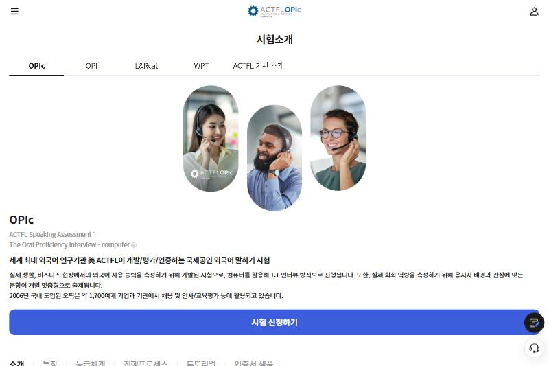
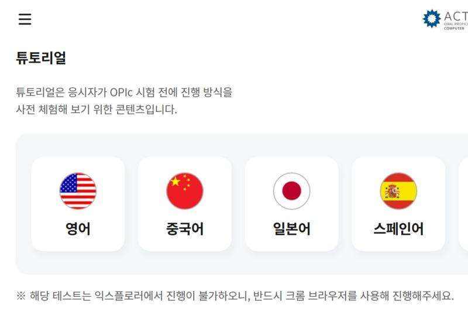
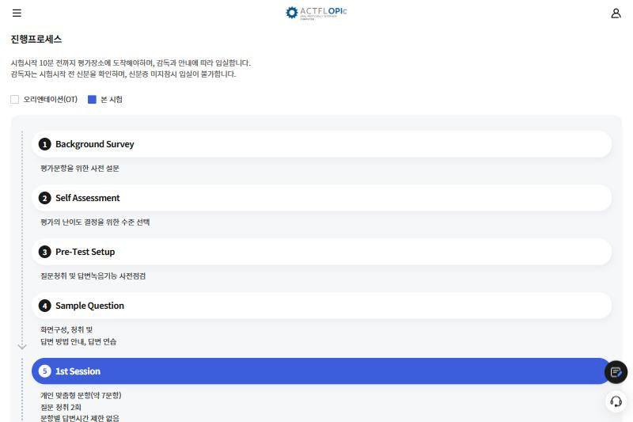
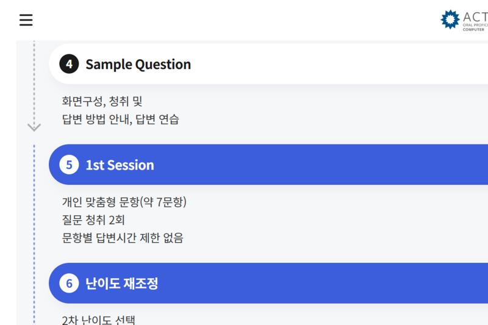

> OPIc 공식 사이트의 튜토리얼로 시험 진행 방식을 미리 체험하는 방법을 정리합니다. 시험소개 페이지에서 영어 튜토리얼을 열고, 실제 시험과 같은 7단계 순서로 진행합니다.

---

## 1. 찾아가는 길

1. OPIc 공식 사이트(`opic.or.kr`)에서 **시험안내 → 시험소개**로 이동합니다.
2. 상단 탭에서 **OPIc**이 선택된 상태인지 확인합니다.

3. 페이지를 내려 하단 메뉴(`소개 | 특징 | 등급체계 | 진행프로세스 | 튜토리얼 | 인증서 샘플`)에서 **튜토리얼**로 이동합니다.
4. **영어**를 선택하면 로그인 없이 체험 화면으로 들어갑니다.

> [!NOTE]
> 체험은 **크롬 브라우저**에서만 진행됩니다(공식 안내: 익스플로러 불가). 마이크와 이어폰을 미리 연결해 둡니다.

---

## 2. 시험 진행 7단계

실제 시험도 같은 순서입니다. 체험에서는 각 단계가 어떻게 동작하는지만 확인합니다.

| 단계 | 이름 | 내용 | 체험에서 확인할 것 |
| :--- | :--- | :--- | :--- |
| 1 | Background Survey | 평가 문항을 위한 사전 설문 | 선택 항목 목록, 최소 선택 개수 |
| 2 | Self Assessment | 평가 난이도를 결정하는 수준 선택 | 1~6단계 설명 문구 |
| 3 | Pre-Test Setup | 질문 청취와 답변 녹음 기능 사전 점검 | 마이크 입력, 음량 |
| 4 | Sample Question | 화면 구성, 청취, 답변 방법 안내와 답변 연습 | 다시 듣기 버튼, 녹음 시작/종료 방식 |
| 5 | 1st Session | 개인 맞춤형 문항(약 7문항), 질문 청취 2회, 문항별 답변 시간 제한 없음 | 문항 사이 이동 방식 |
| 6 | 난이도 재조정 | 2차 난이도 선택(쉬운 / 비슷한 / 어려운 질문 중), 난이도에 따라 문항 수 변동 | 선택지 위치 |
| 7 | 2nd Session | 개인 맞춤형 문항(약 5~8문항) | 마지막 문항 후 종료 화면 |

---

## 3. 체험하면서 메모할 것

- [ ] 설문 화면에서 고를 수 있는 **여가, 취미, 운동, 휴가** 항목 이름
- [ ] 자가진단(Self Assessment) 난이도별 설명 문구
- [ ] 질문 **다시 듣기**를 누르는 방법과 횟수(질문 청취 2회)
- [ ] 녹음이 시작되고 끝나는 시점, 답변 종료를 누르는 방법
- [ ] 난이도 재조정(6단계) 화면에서 선택지가 어떻게 보이는지

---

## 4. 출처

- OPIc 공식 사이트 시험소개 페이지 (2026-10-14 확인): 시험 형식, 문항 수 12~15문항, 시험 시간 40분(OT 포함 약 60분), 진행 프로세스 7단계
- 이미지: 위 페이지 캡처

---

[🔙 뒤로 가기](../index.md)
